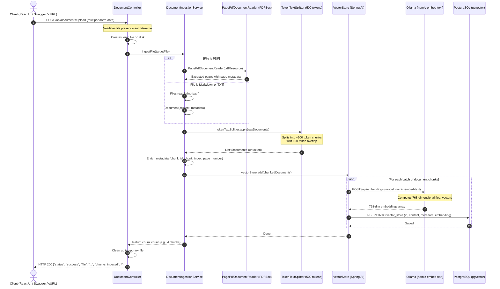

# Document Upload & Ingestion Architecture & Flow

This document details the end-to-end lifecycle of a policy document upload in the **Employee Policy RAG** system—from the client request to vector embedding generation and PostgreSQL storage.

---

## 1. High-Level Flow Diagram



---

## 2. Step-by-Step Breakdown

### Step 1: Client Request
The client uploads a document as `multipart/form-data` to the `/api/documents/upload` endpoint.

* **Endpoint:** `POST http://localhost:8000/api/documents/upload`
* **Content-Type:** `multipart/form-data`
* **Form Field:** `file` (accepts `.pdf`, `.md`, or `.txt`)

#### Example cURL:
```bash
curl -X POST http://localhost:8000/api/documents/upload \
  -F "file=@docs/01_HR_Leave_Policy.pdf"
```

---

### Step 2: Controller Validation & Temporary Buffering
**Component:** `DocumentController.java`

1. **Validation:** Checks if the uploaded file is non-empty and has a valid filename.
2. **Buffering:** Writes the multipart stream to a secure temporary directory (`policy_upload_*`) to allow random access during PDF parsing.
3. **Delegation:** Passes the `File` reference to `DocumentIngestionService.ingestFile(targetFile)`.
4. **Cleanup:** Automatically deletes the temporary file from disk in a `finally` or immediately after ingestion.

---

### Step 3: Text Extraction & Parsing
**Component:** `DocumentIngestionService.java`

* **For PDF files (`.pdf`):**
  Uses Spring AI's `PagePdfDocumentReader` (powered by Apache PDFBox). It reads the PDF page-by-page and extracts:
  - Text content per page.
  - Page number metadata (`page_number: 1, 2, ...`).

* **For Markdown (`.md`) / Plaintext (`.txt`):**
  Reads the file directly using Java NIO (`Files.readString(...)`) and packages the text into a Spring AI `Document` with source file metadata.

---

### Step 4: Token Chunking (Splitting)
**Component:** `TokenTextSplitter`

Large documents cannot be stored as a single vector because:
1. LLM context windows have limits.
2. Smaller, cohesive chunks dramatically improve semantic search accuracy.

The system initializes the splitter with:
```java
new TokenTextSplitter(
    500,  // Target chunk size in tokens
    100,  // Overlap tokens between consecutive chunks
    5,    // Minimum chunk size
    5000, // Maximum chunk size
    true  // Keep document boundaries
);
```

* **Why 100 token overlap?** Prevents losing critical context when an important sentence spans across a chunk boundary.

---

### Step 5: Metadata Enrichment
Each chunk is assigned structured metadata:

| Key | Example Value | Purpose |
| :--- | :--- | :--- |
| `source_file` | `01_HR_Leave_Policy.pdf` | Used for answer citations in chat |
| `chunk_id` | `01_HR_Leave_Policy.pdf_chunk_0` | Unique identifier for the chunk |
| `chunk_index`| `0`, `1`, `2` | Position order in the original document |
| `page_number`| `1` | Page location for exact citation |

---

### Step 6: Vector Embedding with Ollama
**Component:** `PgVectorStore` & `OllamaEmbeddingModel`

1. The Spring AI `VectorStore` takes the chunked documents and makes an HTTP call to the local Ollama instance:
   * **URL:** `http://localhost:11434/api/embeddings`
   * **Model:** `nomic-embed-text`
2. Ollama converts the natural language text of each chunk into a **768-dimensional floating-point vector**.
3. High-dimensional vector coordinates represent the semantic meaning of the text.

---

### Step 7: Storage in PostgreSQL (`pgvector`)
**Component:** PostgreSQL with `pgvector` extension

The chunk text, metadata JSON, and vector embedding are inserted into the `vector_store` table:

```sql
INSERT INTO vector_store (id, content, metadata, embedding)
VALUES (
  '123e4567-e89b-12d3-a456-426614174000',
  'Employees are entitled to 12 casual leaves per calendar year...',
  '{"source_file": "01_HR_Leave_Policy.pdf", "page_number": 1, "chunk_index": 0}',
  '[-0.0124, 0.0451, -0.0892, ..., 0.0135]'  -- 768 dimensions
);
```

* **HNSW Index:** An Approximate Nearest Neighbor index (`hnsw (embedding vector_cosine_ops)`) ensures that later queries can find similar chunks in sub-milliseconds without scanning every row.

---

### Step 8: Response to Client
The controller returns an HTTP 200 JSON response confirming indexing:

```json
{
  "status": "success",
  "file": "01_HR_Leave_Policy.pdf",
  "chunks_indexed": 4
}
```

---

## 3. How Uploaded Documents Are Used Later (RAG Chat Flow)

Once documents are stored in `vector_store`, when a user asks a question (e.g., *"How many sick leaves can I take?"*):

```
User Query: "How many sick leaves can I take?"
   │
   ▼
1. Embed Query via Ollama (nomic-embed-text) -> Query Vector (768-dim)
   │
   ▼
2. Vector Similarity Search in pgvector:
   SELECT content, metadata FROM vector_store 
   ORDER BY embedding <=> query_vector 
   LIMIT 4;
   │
   ▼
3. Grounded Prompt Augmented with retrieved policy chunks:
   "Context: [01_HR_Leave_Policy.pdf - Page 1: Employees get 10 sick leaves...]
    Question: How many sick leaves can I take?"
   │
   ▼
4. Local Ollama LLM (llama3.1:8b) generates answer + citations
```
